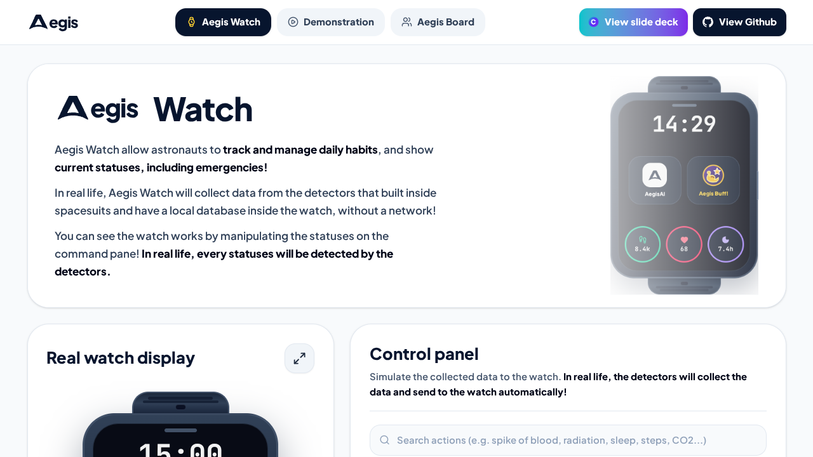
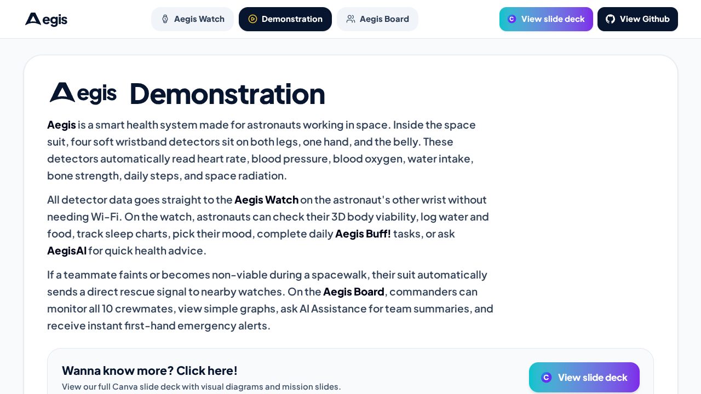
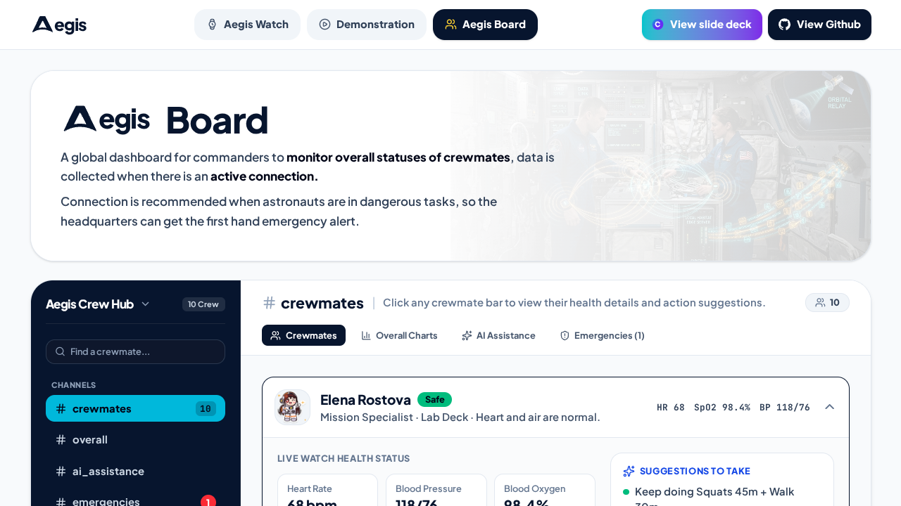

# Aegis

Aegis is a simple smart watch and team board that helps astronauts stay healthy and safe in space.

## 1. Aegis Watch Functions

- **Home Screen & Alerts**: Shows the time on top, colorful safety alerts, and 5 quick buttons (`AegisAI`, `Aegis Buff!`, `Steps`, `Heart`, `Sleep`).
- **Health Tracking**: Check your `H2O Intake` (cups of water), `Daily Steps`, `Heart Rate`, `Sleep Timeline` charts, `3D Viability` body model, `Radiomeasure` shield, `Nutritions` (food log), `Workout` timer, and `Mood` faces.
- **3D Planet Game (`Aegis Buff!`)**: Build your own 3D planet! Complete daily tasks from the side button to earn points, buy new planet colors, and drag and drop trees, domes, and rovers onto your 3D planet.
- **Mini Games & Tools**: Play 10 swipe games with best scores, ask `AegisAI` simple questions, use the bright white `Torch`, or change `Settings` (`Brightness`, `Shortcut Manager`, `Notifications`, `Viewport`, `System & Updates`, `About`).

## 2. Demonstration Functions

- **Suit Detectors Diagram**: Click `Detector 01` to `Detector 04` and `Aegis Watch` on the space suit to see how the sensors read heart rate, water, bone strength, and steps.
- **Real Life Video**: Watch how an astronaut checks their watch and gets a rescue signal when a friend needs help.

## 3. Aegis Board Functions

- **Crewmates Channel**: Click any of the 10 crewmates to see their health numbers and simple action tips.
- **Overall Channel**: View easy bar charts for the whole team.
- **AI Assistance Channel**: Ask simple questions about the crew and get clear answers.
- **Emergencies Channel**: Shows an instant popup alert when a crewmate faints so the team can help right away.
